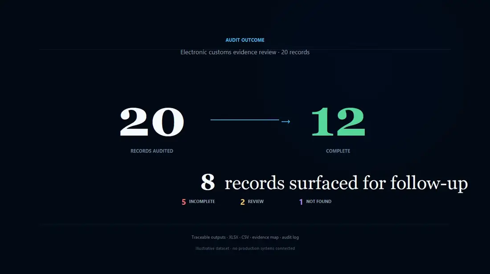
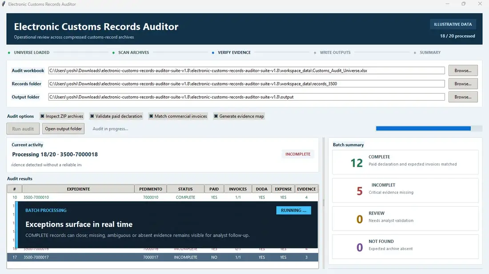
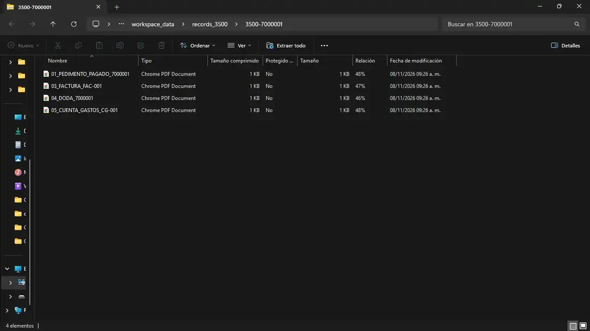
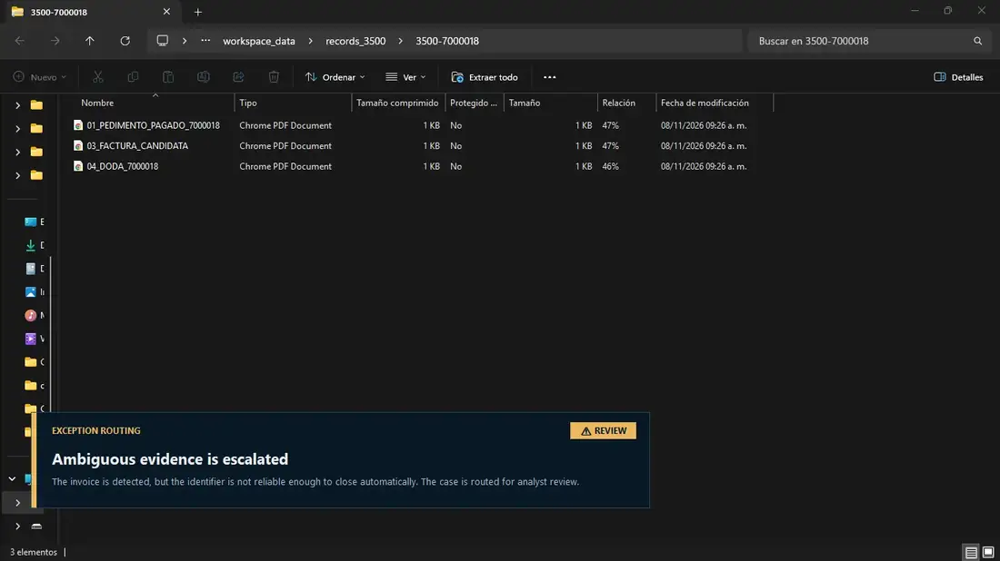
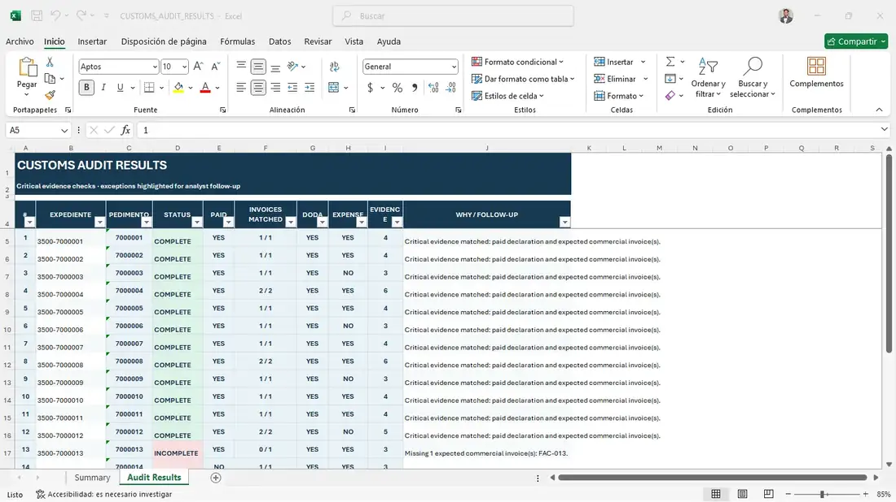
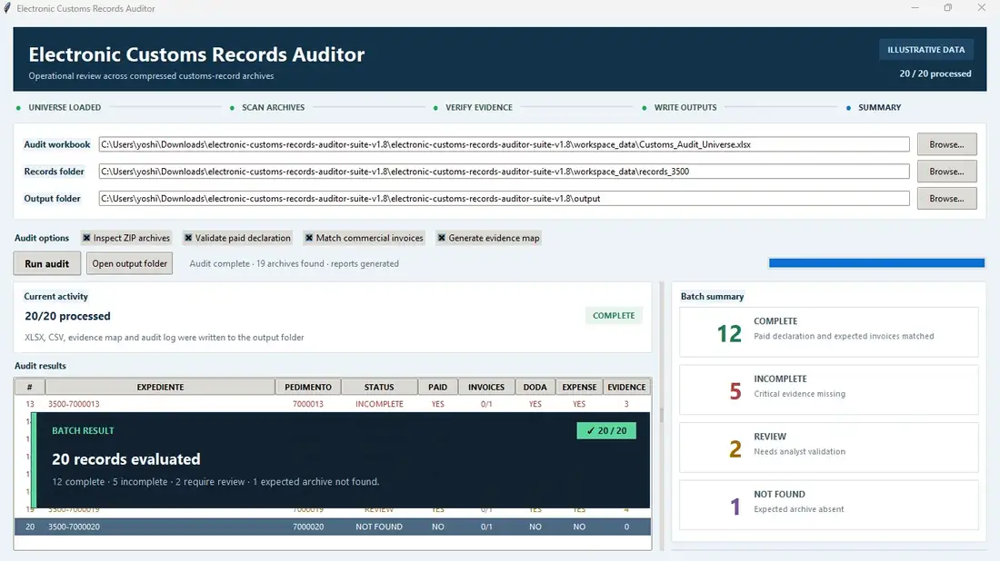

# Electronic Customs Records Auditor

**Portfolio-safe reconstruction of a professional customs-document audit workflow.**  
The project inspects compressed customs-record archives, classifies documentary evidence, matches expected references, routes exceptions and produces traceable audit outputs.

**Python · ZIP evidence inspection · Business rules · Excel reporting · Process automation**

> **Portfolio reconstruction:** this repository contains synthetic customs records only. It does not include company credentials, production customs documentation, internal URLs or proprietary production source code.

[**Live Case Study →**](https://yospadilla.github.io/electronic-customs-records-auditor-demo/)



## At a glance

| Portfolio batch | Archives located | Complete | Follow-up surfaced |
| ---: | ---: | ---: | ---: |
| 20 records | 19 | 12 | 8 |

The 20-record batch above is a synthetic demonstration dataset designed to show the workflow and exception logic. It is not a production-volume claim.

## Why this project existed

Electronic customs records can be fragmented across folders and compressed archives. Manual review requires locating the correct expediente, opening supporting documents and determining whether the critical evidence is complete enough to close the record.

This workflow focuses on making that review more structured by:

- locating the expected customs archive;
- inspecting compressed records without requiring a manual file-by-file search;
- classifying paid declarations, commercial invoices, DODA and expense-account evidence;
- matching expected commercial invoice references;
- routing uncertain evidence to human review rather than forcing an automated decision;
- exporting a traceable Excel report, CSV results, evidence map and audit log.

## Final walkthrough

The repository includes the final edited portfolio walkthrough used to present the project.

[**Watch the MP4 →**](docs/media/electronic-customs-records-auditor-demo.mp4)



## Decision logic

```text
Expected customs record
        │
        ▼
Locate ZIP archive
        │
        ├── Archive missing ───────────────► NOT FOUND
        │
        ▼
Inspect documentary evidence
        │
        ├── Ambiguous invoice evidence ───► REVIEW
        │
        ├── Paid declaration missing ─────► INCOMPLETE
        │
        ├── Expected invoice missing ─────► INCOMPLETE
        │
        ▼
Critical evidence matched
        │
        └─────────────────────────────────► COMPLETE
```

## Evidence match



A record is marked **COMPLETE** when the paid customs declaration and expected commercial invoice references can be matched reliably.

## Exception routing



Commercial evidence that exists but cannot be matched confidently is routed to **REVIEW**. The intent is controlled automation: uncertain evidence remains visible for an analyst instead of being silently accepted or rejected.

## Generated report



Each row represents one audited expediente. The output keeps the determination next to the supporting evidence checks and a concise reason for follow-up.

A sample report is included in [`sample-output/`](sample-output/).

## Portfolio result



The synthetic batch produces:

- **12 COMPLETE**
- **5 INCOMPLETE**
- **2 REVIEW**
- **1 NOT FOUND**

This distribution is intentional so the demo can show all four decision paths.

## What is real vs. simulated

### Based on the professional workflow

- Python-driven customs-document audit logic.
- Inspection of nested folders and compressed customs-record repositories.
- Evidence classification and cross-document matching.
- Traceable exception handling and reporting.
- Operational focus on reducing repetitive manual review.

### Simulated for this repository

- All expediente, pedimento and invoice identifiers.
- The 20-record demonstration batch and its status distribution.
- Synthetic PDF/XML evidence inside the demonstration archives.
- Desktop presentation timing and visual overlays.
- Public sample outputs.

## Architecture

```text
┌──────────────────────────────┐
│ Synthetic audit universe     │
│ XLSX / CSV                  │
└──────────────┬───────────────┘
               ▼
┌──────────────────────────────┐
│ Compressed record archives   │
│ ZIP + synthetic evidence     │
└──────────────┬───────────────┘
               ▼
┌──────────────────────────────┐
│ Audit engine                 │
│ classify + match + route     │
└──────────────┬───────────────┘
               ▼
┌──────────────────────────────┐
│ Desktop workflow             │
│ Python / Tkinter             │
└──────────────┬───────────────┘
               ▼
┌──────────────────────────────┐
│ Traceable outputs            │
│ XLSX / CSV / evidence / log  │
└──────────────────────────────┘
```

## Project structure

```text
.
├── index.html
├── styles/
│   └── app.css
├── docs/media/
│   ├── electronic-customs-records-auditor-demo.mp4
│   └── *.webp
├── desktop-demo/
│   ├── audit_engine.py
│   ├── desktop_gui.py
│   ├── desktop_orchestrator.py
│   ├── generate_demo_data.py
│   └── workspace_data/
├── sample-output/
├── .github/workflows/pages.yml
└── README.md
```

## Run the desktop reconstruction locally

The public case-study page is static, but the repository also includes the Windows desktop reconstruction used for the recorded walkthrough.

From `desktop-demo/`, install the Python requirements and run:

```text
RUN_ALL.bat
```

For a lighter local check without producing the full recording:

```text
RUN_SCREENSHOTS_ONLY.bat
```

## GitHub Pages

The repository includes a GitHub Pages workflow in `.github/workflows/pages.yml`.

Expected public URL:

```text
https://yospadilla.github.io/electronic-customs-records-auditor-demo/
```

## Privacy and intellectual-property boundary

This repository is intentionally a reconstruction for portfolio use, not a publication of an employer's internal implementation. It does not contain production customs records, credentials, internal infrastructure information or proprietary company source code.

## Author

**Yoshio Padilla**

Computer Systems Engineering · SAP · Business Process Automation · Data Analytics
